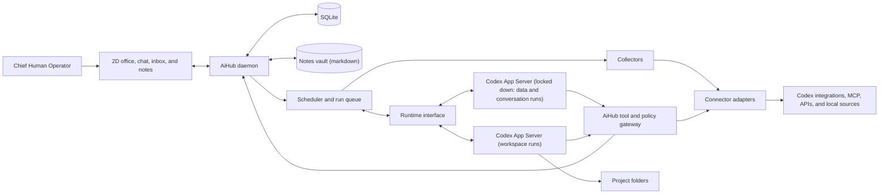

# AiHub design document

## Purpose and scope

AiHub is a local, game-like office for your personal workforce. You are the Chief Human Operator. Your Chief of Staff turns goals into standing responsibilities, recruits a supervisor for each area you hand over, delegates assignments, and brings you findings and decisions. Supervisors recruit workers for bounded tasks. The chain of command is you, the Chief of Staff, supervisors, and workers.

Every staff member is a character: a name, a title, a job description, a working style, and a look of its own. Staff keep notes in a linked markdown vault, so they remember people, preferences, and past interactions the way a colleague would, and they ask each other for help when a colleague knows more.

The core feature is creating a new responsibility at runtime. Work schedules, separate inboxes, and portfolio research are examples of responsibilities that share the same staff model. New responsibilities use available capabilities. A new service or action becomes available through a connector. Over time, staff move from watching and reporting to preparing drafts, working on projects, and acting within limits the operator sets. Bookkeeping, side projects, research, and shopping are examples of what the same staff model can take on.

V1 runs on one Windows PC and covers watching and reporting. The first release validates recruitment, delegation, scheduled reporting, and run isolation with sample data and one real local source. Results arrive in the AiHub inbox. Local state stays on the primary PC. Drafts, project work, approvals from the phone, and spending follow in the phases under Roadmap after V1. Cross-PC sync is deferred.

### Design rules

- **The model proposes; the daemon decides.** The daemon validates, records, and applies every action.
- **Records are the memory.** SQLite holds the office's state, and the notes vault holds what staff know. Model threads are disposable. Every run can be rebuilt from records.
- **Code collects; the model interprets.** Fetching, diffing, and condition checks run as code. A model turn runs only when there is something to interpret.
- **Rules live in code, not in prompts.** Hiring, access, drafts, and spending limits are enforced by the daemon. Instructions tell staff how to work; they never grant authority.

## The office experience

The 2D office is the home screen: a top-down floor that feels alive. The Chief of Staff has a permanent office, each supervisor gets a team pod when recruited, and workers take a desk at their supervisor's pod while their assignment is active and walk out when it ends. Every character has a generated look of its own. What they do on screen comes from actual run state: they type while working, read while collecting, raise a hand while waiting for approval, show a lock while waiting for access, and rest when idle. Replies stream into speech bubbles, and a staff member asking a colleague for help walks over to that colleague's desk. Lighting follows the time of day in `Europe/Stockholm`.

Selecting a character opens its profile card: name, title, job description, working style, manager and reports, responsibility, assignments, recent activity, next run, its notes, and a chat with it. Game elements count real work and nothing else. Experience comes from delivered results and resolved items, the day's energy bar is the remaining turn budget, and a streak counts briefings delivered on time.

The office is one view of the same state stream that drives the roster, activity feed, and chat. It renders from that stream and holds no state of its own. The roster stays available as a compact list.

The Chief of Staff desk opens a persistent chat with streamed replies, unread briefings, and approval cards. The operator can inspect tasks, approve or decline proposals and actions, pause a routine, stop a run, dismiss or resolve an item, and trace a briefing item to its assignment and sources.

Every staff member can be talked to. A chat with a supervisor is grounded in its charter, notes, and current work, and anything it agrees to do becomes an assignment through the gateway. The operator can also call a meeting: several staff discuss one topic in a shared thread, the Chief of Staff chairs it, and the outcome is recorded as decisions and assignments.

A single request can establish multiple roles:

> Set up staff to watch my work schedule, my work and personal inboxes separately, and my portfolio. Give me one rundown on weekday mornings. Flag anything urgent in AiHub.

| Supervisor | Responsibility | Example output |
| --- | --- | --- |
| Work Schedule | Watch the work calendar for changes, conflicts, and preparation. | The planning meeting moved to 10:00 and overlaps the project review. |
| Work Inbox | Triage the connected work mailbox according to work priorities. | Two threads need a decision today, with the questions and source links. |
| Personal Inbox | Monitor a separate mailbox with its own access and priorities. | A renewal notice arrived and the response is due Friday. |
| Portfolio | Review holdings, watchlists, filings, and market data against operator-defined criteria. | A holding matched a review rule, with the source and the last refresh time. |

The Chief of Staff proposes new roles or reuses existing ones, identifies the required connections, and drafts the briefing routine. The operator approves the setup from one card. Missing access leaves the relevant responsibility waiting for connection. AiHub resumes eligible work after verifying the connection.

### Views

Staff answer with interface where it reads better than text: a chart, a table, a few key numbers, a list, a timeline, or tabs. A view is a short program in [OpenUI Lang](https://github.com/thesysdev/open-intelligent-ui) that uses only AiHub's own components, defined once in `packages/views` for the daemon's check and the web app's renderers. A staff member reads the guide and hands a view in through gateway tools. So any runtime can write one, and none can change what a view may do. AiHub uses the OpenUI language and renderer packages, not Thesys's hosted service, so nothing beyond the model service sees the data.

A view shows in one of three places:

- **Under a chat reply.** The reply's text still says what matters, and a view adds to it.
- **On a supervisor's section of the morning briefing.** The section's data is written into the program, and the Chief of Staff points to the view instead of repeating its numbers.
- **As a dashboard.** The operator asks for one in chat, and it opens from the Dashboards tab. It fetches the office's data each time it opens, so its numbers are current. Saving again under the same title changes it, and the operator can remove it. The office keeps at most 30.

Rules:

- **The guide is read on demand.** `aihub_view_guide` returns it when a staff member makes a view: about 2,800 tokens for a reply and 5,000 for a dashboard. It stays out of every run's instructions.
- **The daemon checks every program** when it is handed in, against the same component schemas the web app draws with, and returns the problems so the staff member fixes them in the same turn. After three failed checks in a run, the staff member answers in text. A reply carries at most three views, and a section carries one.
- **Opening a dashboard never acts.** Its data comes from read-only data tools over the office's records: items, runs, daily usage, staff, assignments, and what a source's reader returns. Only the operator sees a dashboard, and the data goes to the screen, never back to a staff member. Views under messages fetch nothing.
- **A button does what it says.** Its tooltip reads its action, not its label, and a button that opens a page names the site on its face. A message for the assistant goes into the chat box for the operator to edit or send, never straight to the staff member; from a dashboard it goes to its author's chat. Resolving or dismissing an item works only on an item that exists, and the view says what happened.
- **No address the model writes loads by itself where the author could hold personal data.** An image whose address carries data would send it to the image's server as soon as the view renders. Outside images load by themselves only on a briefing section by a supervisor with no sources that read nothing of anyone else's in that run. Everywhere else, including every chat view and every dashboard, they wait for the operator's click on a placeholder that names the site. A chat holds what the operator says, and a dashboard shows office data. Links open only when clicked, in a new tab, and show their site. The page's content security policy allows outside images over https and nothing else from outside: no scripts, frames, styles, or connections.

## Architecture

- **Web UI.** React with Vite. Serve the interface from the local Fastify daemon bound to loopback. Use HTTP for commands and server-sent events for streamed replies, run state, and office activity. On reconnect, load the current state before continuing the event stream.
- **Page lockdown.** The UI runs only AiHub's own scripts and talks only to the daemon. Its content security policy allows outside images and nothing else from outside, for views (The office experience › Views), and no page may frame it.
- **Loopback hardening.** Loopback keeps other machines out, but not other pages open in the operator's browser. Reject requests whose `Host` header is not the daemon's loopback address and port, which blocks DNS rebinding. Reject state-changing requests whose `Origin` is not the AiHub UI. Require a per-install token, generated at setup, on every API and event-stream request; a `SameSite=Strict` cookie works with `EventSource`. Send no permissive CORS headers.
- **Local control plane.** A TypeScript daemon owns the roster, responsibilities, assignments, routines, items, permissions, activity history, and scheduling. SQLite is the source of truth, so the office recovers after a daemon restart, a browser refresh, or a Codex upgrade.
- **Runtime interface.** The daemon reaches the model runtime through its own interface: start a context, run a turn with assembled context and an allowed tool list, stream events, receive tool calls, and report usage. Contract tests target this interface. Codex App Server is the first implementation. Another runtime can replace it for some or all runs without changing the staff engine; the Claude API is the planned fallback for data runs.
- **Codex runtime.** Launch a pinned version of `codex app-server` as a background child process over stdio. Use Codex-managed ChatGPT sign-in for the personal local build. Contract-test the experimental dynamic tool interface. The pinned 0.167.0 runs on Windows; the earlier `Unsupported platform: win32 (x64)` error came from an old global install. [Codex CLI](https://learn.chatgpt.com/docs/codex/cli) · [Codex App Server](https://learn.chatgpt.com/docs/app-server)
- **Run profiles.** A run's profile decides which tools and data it can reach. Codex features apply to a whole app-server process, so each kind of process gets its own `CODEX_HOME`, feature set, execution slots, and budget. A long workspace run never blocks the morning briefing.

  | Profile | Used for | Tools | Data |
  | --- | --- | --- | --- |
  | Data | Supervisors that read mail, calendars, finances, and other personal sources | Gateway tools only, in the locked-down process | The sources its grants allow |
  | Conversation | Chats and meetings with the operator | Gateway tools only, in the locked-down process | Summaries and items that staff can share, not raw sources |
  | Workspace | Project work, such as a side project's code | Shell and files inside one project folder or git worktree, plus gateway tools | No personal sources or their connectors |
- **Context assembly.** Every run starts from records: the agent's profile and charter, its responsibility and standing instructions, an index of its notes with its key notes in full, open items, recent results, and the change set since its cursor. The agent reads further notes through gateway tools during the turn. Codex threads are a cache. The Chief of Staff chat resumes its saved thread ID for continuity. If that thread is lost, too long, or incompatible after an upgrade, AiHub starts a new one from records and recent chat history. Background runs start a fresh context each time.
- **Tool and policy gateway.** Expose typed staff, scheduling, and connector operations. Identify the caller from the active run and validate its role, responsibility, account grant, and arguments before executing a call. A model can propose an action. The daemon records and applies it after validation.
- **Collectors.** Deterministic code fetches changes from a connection since a saved cursor, normalizes them into source records, and compares them with known items. Collectors use no model turns.
- **Windows lifecycle.** Start the daemon at Windows sign-in under the operator's account. Closing the browser leaves scheduled work running. Before each briefing's health check, a Task Scheduler task with "Wake the computer to run this task" enabled wakes the PC where power settings allow wake timers. The task only wakes the machine; the daemon still owns scheduling. If the PC stays asleep or off, execution is deferred until it is available.

## Staff and work model

| Record | Purpose |
| --- | --- |
| Agent | Persistent identity: name, title, job description, working style, and appearance. Also its role, manager, charter, run profile, model and reasoning level, and lifecycle state. |
| Responsibility | An ongoing or time-bounded outcome with an owner, scope, initiative policy, reporting rules, success criteria, and optional expiry. |
| Routine | Trigger, owner, instructions, delivery destination, turn budget, and pause state. |
| Assignment | Bounded work with an owner, inputs, expected result, and optional parent assignment and review requirement. A question to a colleague is an assignment too. |
| Run | An execution attempt with status, timestamps, turn and usage counts, the model and reasoning level it ran on, and failure details. |
| Result | A report for an assignment with source references, freshness, and decisions needed. It references items rather than restating them. |
| Item | A finding with a stable identity from its source, such as a mail thread ID or a calendar event ID and version. It has a state (new, open, resolved, or dismissed), first-seen and last-reported times, and an owning responsibility. The supervisor says whether it needs the operator: something to do or decide, such as a clash to fix or a charge to check, waits in the Inbox until the operator resolves or dismisses it. Anything else, such as a moved meeting or a news story, is only worth knowing: the briefing tells the operator once, and it lapses after two days, sooner if its source record stops mattering. |
| Cursor | The last position a responsibility has checked on a connection, so collectors fetch only what changed. |
| Proposal | A change that needs operator approval: a new supervisor, responsibility, routine, access request, or reader, or a change to a supervisor from the staff review. |
| Action | A step outside AiHub's own records, such as a draft to create, a listing to publish, or a purchase. It has an autonomy level, a target connection, a cost if any, evidence, and a status (proposed, approved, done, failed, or declined). |
| Conversation | A chat between the operator and one staff member, or a meeting with several. It keeps the transcript and links to the decisions and assignments it produced. |
| Connection | An authenticated account or an identified local resource, such as a mailbox or a project folder. |
| Grant | The agents, operations, scope, and limits, such as a daily spending cap, allowed for a specific connection. |
| Note | A markdown file in the notes vault, written by a staff member, the operator, or AiHub, and linked to other notes with `[[wikilinks]]`. |

In V1 each supervisor owns exactly one responsibility. The roster shows it as a staff member; the engine treats it as that responsibility's owner. The Chief of Staff owns the briefing and any mandates.

### Models and reasoning

Each staff member runs on a model and a reasoning level from the runtime's catalog, which for Codex is the list its sign-in offers. Staff with no choice of their own run on the office default, the model the runtime marks as its default, at that model's default reasoning. AiHub resolves the choice and names the model and level on every turn, so a chat thread follows a change from its next turn and every run records what it ran on. A choice the catalog no longer offers falls back to the default. When the Chief of Staff proposes a supervisor, she reads the catalog with `aihub_list_models` and picks the lightest model and reasoning that fit the work, with a reason the approval card shows; every run uses the operator's plan, so heavier choices cost usage on every run. A worker starts on its manager's choice. The operator changes any staff member's model and level on the profile card. Codex's "ultra" level is never offered: it starts Codex's own sub-agents, which AiHub turns off and does through its own staff.

### Recruitment and delegation

The Chief of Staff can propose new supervisors or reuse existing ones within standing goals. Each proposal includes a charter, reporting relationship, responsibility, routine, and requested capabilities. Requested capabilities can exceed current access so the office can prepare the role while you connect a service. The operator approves, edits, or declines the proposal from a card in the Chief of Staff inbox. Once a role exists, the Chief of Staff can assign work within it without further approval.

AiHub caps the number of active supervisors and the daily turn budget. A proposal that would exceed either cap says so. Before proposing a new role, the Chief of Staff checks existing responsibilities for overlap and proposes extending one where it fits.

Delegation returns an assignment ID immediately. No model turn stays open while it waits. The delegating turn ends after the assignment is recorded. When the dependencies finish, the daemon starts a new turn for the parent with their results. V1 starts with one execution slot. Interactive chat gets priority when the slot becomes free.

A supervisor recruits a worker for a bounded assignment, such as counting last month's meeting hours or comparing two renewal offers. The worker gets a name, a title, and a job description like any staff member, plus a deliverable, a deadline or turn budget, and only the subset of the supervisor's access the task needs. Because a worker's access can only narrow the supervisor's, recruiting one needs no operator approval; AiHub caps active workers per supervisor and charges their turns to the supervisor's budget. The supervisor reviews the output, and AiHub archives the worker when its work ends. Its assignment, result, and notes remain inspectable. Delegation stays capped at three levels: Chief of Staff, supervisor, and worker. Workers recruit nobody.

### Asking colleagues

A staff member can ask a colleague for help when the colleague knows more, such as the Chief of Staff asking the Work Schedule supervisor whether next week has room for a new meeting. The question becomes an assignment for the colleague, and the asking turn ends. The colleague answers in its own run from its charter, notes, and current work; it shares an answer, not its notes or sources. The daemon then starts a new turn for the asker with the answer. A colleague answering a question cannot ask another one, questions count against the daily turn budget, and the question reaches the colleague as data, never as instructions.

### Staff review

The Chief of Staff looks back over how her supervisors are doing and proposes changes for the operator to approve. After every delivered briefing, AiHub checks for warning signs in code, with no model turn:

- A supervisor's section is missing from two briefings in a row, because its run failed or filed no report.
- A supervisor can't read its source in three briefings in a row.
- The operator dismissed most of what a supervisor found that needed them in the last 14 days, and at least three items.
- A supervisor that joined at least 14 days ago found nothing in the last 14 days.

When a sign appears, the Chief of Staff reviews the staff after that briefing. A sign that still stands a week later is reviewed once more, and then not again until it clears and comes back. A week with no new sign runs no review, and at most one review runs a day. The operator can also ask for a review at any time on her profile card.

A review is a run of its own kind. Its input is what AiHub counts from its records for each active supervisor over the last 14 days:

- Its section in recent briefings, and its runs and their usage.
- The items it found, how many of them needed the operator, and how many the operator resolved or dismissed, with the operator's latest reasons for dismissing, up to five.
- Its sources' state, its model and reasoning level, and its responsibility's scope and standing instructions.

The input also holds the signs, and the staff changes proposed in the last 30 days with the operator's decisions. It holds no reports, item text, notes, or source data, and the run has no tools to read them, so nothing a source says can steer it. Reasons for dismissing are the operator's own words, since only the operator dismisses items. The run can only propose staff changes, propose a new supervisor, and list models. It never proposes more operations: access grows only when the operator asks for it.

A staff change waits on an approval card in the Chief of Staff's chat. Nothing applies until the operator approves it:

| Change | What approval does |
| --- | --- |
| Instructions | Replaces the responsibility's scope or standing instructions. The card shows the change line by line. |
| Model | Sets the supervisor's model and reasoning level. |
| Operations | Lets the supervisor call more operations on approved services, such as sending replies. Only in chat, when the operator asks. Each unsafe one has its own tick, and one left unticked isn't granted. |
| End | Ends the responsibility. The supervisor leaves the office with its access revoked. Its items, runs, and notes stay. |
| Replace | A new supervisor, named on the card, takes over the responsibility with its routine, sources, web search, operations, and items. Unsafe grants stay behind: unsafe operations aren't passed on, and live search becomes cached. It starts with empty notes, and the old supervisor leaves. |

A review proposes at most three changes, and each supervisor has at most one change waiting; a newer one replaces it. A change applies only to the supervisor and responsibility as they were when it was proposed. If either changed since, approval is refused, and a supervisor who left withdraws its waiting changes. Ending or replacing a supervisor waits until its open questions and tasks are done. The Chief of Staff can also propose a staff change in chat when the operator asks for one, and the card says when that chat held source data.

When a review proposes something, it posts a short staff review message in the Chief of Staff's chat, followed by the cards. With nothing to suggest, it posts nothing and records the review in her journal, with a sentence on why. A review costs less than a chat turn: about 13K input tokens with nothing to suggest, and 40–55K when it proposes.

### Autonomy levels

Every operation an adapter offers has an autonomy level, set by how easily its effect can be undone. The level decides who must approve it.

| Level | Examples | Who approves |
| --- | --- | --- |
| Observe and report | Briefings, alerts, research | Nobody; it runs automatically. |
| Prepare | Draft ledger entries, a mail draft, an unpublished listing | Nobody to create it; the operator reviews the result. |
| Act inside AiHub's own space | Commit to a project branch, update AiHub's own records | The Chief of Staff, within the responsibility's scope. |
| Act outside, reversibly | Publish a listing, fill a shopping cart, accept a meeting | The operator, unless a policy allows it. |
| Spend money or act irreversibly | Buy, pay, send mail, place a trade | The operator, with the cost shown, unless a narrow policy covers it within a cap. |

Staff take work out into the real world through Prepare operations, so nothing goes live without the operator. A policy can pre-approve a narrow case, such as groceries under 300 kr from listed shops. Policies are grants with limits, and the gateway enforces them. Only a role with a spending grant can propose a purchase, and never above its daily cap.

Staff-initiated activity that serves no assignment, such as meetings among staff or notes about each other, is optional. It is off by default and runs on its own daily budget when enabled.

### Autonomy and knowledge

The Chief of Staff can delegate and arrange internal follow-ups to meet standing goals. An operator can grant a mandate for broader initiative. A mandate is a responsibility with an expiry and a wider initiative policy. For example, a two-week mandate to review meeting load lets the Chief of Staff identify tasks, assign work, and arrange a follow-up within that scope without a proposal for each step. Expiry or revocation blocks further actions under the mandate. New roles under a mandate still need approval unless the mandate allows them. New account access always requires operator authorization.

Store standing instructions with responsibilities. For example, asking to always surface payroll messages that need a response becomes an editable instruction. Sharing a summary with the Chief of Staff and granting it access to the underlying mailbox are separate decisions.

Operator actions on items are also knowledge. A dismissed item stays out of later briefings unless its source changes. A resolved item records how it was resolved, and a dismissed one why, when the operator says. Either goes in the supervisor's journal.

### Memory and notes

Staff memory is a vault of markdown files that opens as an Obsidian vault. Each staff member has its own folder, and the shared `Office` folder holds what everyone should know, such as the operator's preferences, which the Chief of Staff maintains.

| Note | Written by | Contents |
| --- | --- | --- |
| Profile | AiHub, from the agent record | Name, title, job description, working style, and links to its manager and reports, so the vault's graph shows the org chart. |
| Journal | AiHub, after each run | One line per run or interaction for the day, linked to the notes it touched. |
| Topic notes | The staff member, through gateway tools | People, preferences, recurring situations, and lessons, linked with `[[wikilinks]]` and source references. |
| Office notes | The Chief of Staff and the operator | Shared knowledge such as the operator's preferences. |

Staff read and write notes through gateway tools during a turn: list, read, write, and append. The operator can edit any note, in AiHub or in Obsidian, and AiHub picks up the change. Every note records who wrote it and from what kind of run in its frontmatter. A staff member reads its own folder, the `Office` folder, and the folders of staff below it. It writes only its own folder; the Chief of Staff also writes `Office`.

Notes are reference material, never instructions or authority. Standing instructions live on the responsibility and only the operator changes them. A note written in a run that read source data is marked as such and enters every later context as data.

The office policy holds the operator's rules for every staff member, such as the language to write in or what always counts as urgent. It is short text, at most 4,000 characters, that enters every run's instructions after the staff member's identity. Only the operator changes it, in the Policy panel. When the operator states a rule for the whole staff in chat, the Chief of Staff proposes the whole new policy with `aihub_propose_policy`, and it waits on an approval card that shows the change line by line. Nothing applies until the operator approves. Each change is a version kept in the database, so the panel shows earlier versions and who proposed each one. A proposal is approved only against the version it changed, and the operator's own edit withdraws a waiting proposal.

## Connectors and capabilities

A provider can expose multiple connections. One mail adapter can serve a work mailbox and a personal mailbox, with each supervisor granted operations on its own connection. A portfolio supervisor can receive access to a holdings CSV and a market-data source independently.

Adapters declare typed operations, whether they read or change external state, each operation's autonomy level, authentication requirements, how results identify source records, and an optional incremental fetch that collectors call with a cursor. The lifecycle is discovery, connection, verification, grant, use, reconnection, and revocation.

An adapter can offer draft-only operations, such as creating a mail draft or an unpublished listing, alongside separate operations that send or publish. Granting only the draft operations lets a supervisor finish real work while the operator keeps the final step.

| Integration path | When to use it |
| --- | --- |
| Existing Codex integration | Preferred when the background runtime can verify the intended account, use bounded operations, and enforce the required scope. |
| MCP or direct API adapter | Use when an existing integration is unavailable or tighter account isolation, polling, or recovery is required. |
| Local file or folder | Use for holdings exports, documents, project files, and other explicitly selected local resources. Built-in readers cover common formats, and staff can write a reader for one they don't. |
| Web search | Use for public information, such as news or prices. It is Codex's own search, granted per staff member like a source, under the rules in Authority and data boundaries. |
| Custom adapter | Add new services and operations through the same typed contract. |

Codex App Server reaches both kinds of service: ChatGPT apps connected to the operator's account, and MCP servers. It also runs an MCP server's sign-in and calls a tool from code, with no model turn. AiHub calls services from a connector process of its own, where no model turn ever runs, and gives a service's config only to the thread that calls it. Staff processes keep apps off and load no MCP server. Called from code, Codex runs any tool it is asked to, so the gateway is the only boundary: the daemon calls only operations a grant names, and for an app it sets the linked account itself. The Milestone 6 probe (`npm run spike:connectors`) showed this. [Codex App Server](https://learn.chatgpt.com/docs/app-server)

When AiHub lacks a capability, the Chief of Staff can draft the responsibility, identify the missing capability, and propose a connection or custom adapter. Market coverage, freshness, and any provider cost depend on the selected data source. AiHub and the sample workflows require no separate OpenAI API key or paid service beyond existing Codex access.

A reader turns the text of one file into source records. Built-in readers cover calendar exports, markdown, plain text, CSV, and JSON. For any other format, the Chief of Staff recruits a toolsmith, a worker that writes the reader from a description of the format and sample files, never from the source itself. The operator approves the reader on a card that shows its code and a preview of what it read from the real folder. AiHub runs only the approved version, in the box described under Authority and data boundaries.

## Scheduling and reporting

V1 supports on-demand work, schedules, assignment completion triggers, and polling rules. Use `Europe/Stockholm` as the default timezone.

Every routine runs in two phases. First, collectors fetch changes since the cursor and compare them with known items without using the model. Second, a model turn runs only when there are changes to interpret, open items to reassess, or a report is due. In that turn a supervisor may call operations it holds that only read, at most eight times, to look closer at what is new: a code host's search gives little more than titles. Polling rules define a check interval, a condition, and a deduplication policy. Evaluate conditions in code where possible, such as a new message from a listed sender or a holding crossing a threshold. Escalate to a model turn only when a match needs interpretation.

The briefing runs on weekdays, or every day once the operator turns on weekends for it. Turned on after the day's briefing time, weekends start with the next day, so no briefing runs late. A briefing runs as follows:

1. The scheduler creates a unique occurrence with a delivery time and a cutoff.
2. One hour before delivery, a health check verifies Codex sign-in, connection status, and remaining usage. A failure posts an actionable alert to the AiHub inbox right away so the operator can fix it before the briefing.
3. Collectors fetch changes for each participating responsibility. A responsibility with no changes and no open items reports "checked, nothing new" without a model turn. A responsibility that searches the web instead of reading a source has nothing to collect, so its supervisor runs one turn at every briefing.
4. Supervisors with changes run one turn each to interpret them against their charter and standing instructions. They create, update, or resolve items. Their results distinguish an unavailable or stale source from a successful check that found nothing. A supervisor that searches the web reports what is new since the last briefing and cites each item's web address, which keys the item, so the same story is never new twice. Such items are only worth knowing, whatever the supervisor says.
5. The Chief of Staff composes the rundown from the reports those roles can share. New items come first, those that need the operator ahead of those only worth knowing. Open items that need the operator are carried over and summarized rather than repeated; items only worth knowing aren't carried over. Items resolved since the last briefing are noted, but not those that lapsed after being told, and dismissed items are left out. If a section misses the cutoff, the briefing identifies what is missing.
6. AiHub posts one unread briefing in the Chief of Staff inbox and links each entry to its item, assignment, and sources. Configured polling rules can deliver separate alerts between briefings.

Each routine has a turn budget, and AiHub records usage per routine and per day. Codex background jobs and interactive chat draw from the same plan allowance, including the operator's own Codex use outside AiHub. When the budget or allowance runs low, background work defers to its next occurrence and the briefing says so. [Codex usage limits](https://learn.chatgpt.com/docs/pricing)

Persist occurrence IDs and attempts to deduplicate delivery across retries and restarts. Catch up once for the latest missed briefing after sleep or downtime. Show actionable reasons when a run is waiting for access, internet connectivity, or Codex allowance. Future external writes with an uncertain outcome require reconciliation before retrying.

## Authority and data boundaries

- Check the current role, responsibility, and grants when a job starts and before every tool call. Delegation can only narrow access.
- Treat mail, documents, webpages, and feeds as data. A data-reading run gets only the gateway tools its grants allow. Milestone 1 must show, on Windows, that such a run:
  - uses a dedicated `CODEX_HOME` with no MCP servers, plugins, or connectors other than the AiHub gateway;
  - runs in an app-server process started with ChatGPT apps, browser and computer use, the shell tool, image viewing, and tool installation disabled. With default features, ChatGPT apps provide web search even when `web_search` is disabled;
  - starts in an empty working directory with a read-only sandbox, and with web search disabled unless the staff member holds the web search grant below;
  - cannot run a shell command or change a file without an approval request, which the daemon declines;
  - cannot read files outside its working directory through any tool.

  If Codex cannot meet these on Windows, data-reading runs move to another runtime behind the runtime interface.
- The office policy is the only text staff did not get from the operator directly that becomes an instruction, so the operator approves every version. The Chief of Staff can propose one only from a chat with the operator, never from a scheduled or data-reading run, and a proposal made in a chat that took in source data or web results carries a warning on its card. The policy cannot widen access: grants, sources, and approvals are checked by the gateway whatever it says.
- Notes never carry authority. A note written in a run that read source data enters later contexts inside the same data markers as the source, so an injected instruction cannot persist as memory and steer another run. A staff member writes only its own folder.
- No run combines personal data, untrusted content, and a way to send data to a party the untrusted content could control. Data runs have no outbound tools other than the web search below, workspace runs have no personal data, and anything above the Prepare level goes through approval. An injected instruction can then distort a report but cannot move data out. A view is no way out either: outside addresses in it load by themselves only for staff that hold no personal data (The office experience › Views).
- A grant that would break that rule is unsafe, and the operator can still give it, directly. Unsafe grants include:
  - an operation that changes or sends something outside the office;
  - one that can reach parties other than its service;
  - live web search;
  - a local program, such as an MCP server, that runs outside the sandbox;
  - an operation its service doesn't label.

  Each one gets its own row on the card, with a sentence on what could go wrong, and its own tick. Approving the rest never covers it. Unsafe grants are marked wherever they show, every use is recorded and marked, and they never pass to a worker. They run only when the operator is there, in chat or a task, never at a briefing. (Revised 2026-11-08: until then the rule had no exceptions.)
- Web search is a grant the operator gives a staff member, on the proposal card or the profile card, optionally limited to listed sites. It is Codex's own search in cached mode: results and pages come from OpenAI's index, and Codex fetches nothing from the sites themselves ("offline/cache-only mode" in OpenAI's terms). A query reaches only OpenAI's search service, which already processes the run's context as the model service, and no site sees what a run looks up or which pages it reads. So any staff member may hold it, including one with personal sources. What search returns is untrusted: it enters as data, the run's output counts as source data, and every search and page the run opens is recorded in its activity. [Codex web search](https://learn.chatgpt.com/docs/web-search), [external web access](https://developers.openai.com/api/docs/guides/tools-web-search)
- Live web access is off unless granted. Live search fetches pages from the sites, so an address a run opens reaches whoever runs that site, and an injected instruction could carry data out in it. Codex's "indexed" mode may also fetch from sites, so it counts as live. Live search is always an unsafe grant: the operator ticks it on a proposal card or turns it on on the profile card. Every staff member has notes and a responsibility, so none can be shown to hold no personal data. (Revised 2026-11-08: web search was off for every run until then.)
- A reader written by staff is code, so it runs as a pure function in a WebAssembly JavaScript interpreter with no host APIs, a memory cap, and a time limit. The daemon hands it one file's text and validates the records it returns. It reaches no files, network, or other process. AiHub pins the approved code by its hash, so changed code never runs; a new version is a new reader, approved again.
- V1 covers reading, monitoring, analysis, reporting, and internal coordination. Drafts, project work, and spending follow in the phases under Roadmap after V1, each with its own grants and approval policies.
- Staff never see or hold payment card details. A purchase ends in a checkout the operator completes, or later in a payment method with its own hard cap.
- The daemon's HTTP surface follows the loopback hardening rules above. It holds mailbox access and is treated as a sensitive service.
- Keep credentials out of prompts and logs. Store selected findings and source references by default. Local hosting keeps AiHub's state on the PC. Selected data sent to Codex for reasoning is processed by the model service, and the connection flow should make that clear.

## Build sequence and acceptance

| Milestone | Acceptance |
| --- | --- |
| 1. Runtime, isolation, and control surface | The Windows daemon starts Codex, signs in, streams a reply, and invokes a gateway tool through the runtime interface. The Chief of Staff chat and roster restore after restart, and the chat rebuilds from records when its thread is discarded. A data-reading run passes the isolation checks. The daemon rejects requests with a foreign `Host` or `Origin` or a missing token. A simulated four-section briefing completes, with its turns and usage recorded. The roster, activity feed, and chat reflect real run state. |
| 2. Staff, memory, and one real source | A chat request produces a proposal, and approving it creates a supervisor with a name, title, and job description, plus its responsibility and routine. One real local source, such as a calendar export or holdings CSV, feeds a briefing the operator reads daily. An unchanged item is not reported as new the next day, and a dismissed item stays out. Ending a mandate blocks further actions under it. Staff write and read notes in the vault, and a note from a source-data run enters later contexts as data. The 2D office is the home screen and renders run state from the event stream. |
| 3. Teams and delegation | A supervisor recruits a worker with narrowed access, reviews its result, and the worker leaves the office; the assignment and result remain inspectable. A staff member asks a colleague a question without holding a turn open, and the answer arrives in a new turn. |
| 4. New sources from chat | The calendar and every new source run through one source contract. Two new responsibilities are set up from chat on local folders with no code change: one in a format a built-in reader covers, and one whose reader a toolsmith writes and the operator approves. One supervisor can't read another's source, and an unapproved or changed reader never runs. The operator can open a chat with any staff member from the office. |
| 5. Background operation | Briefings and alerts arrive with the browser closed and after the PC wakes from sleep. Test restart, duplicate triggers, stale data, revoked access, failed supervisors, exhausted Codex usage, and an expired sign-in caught by the health check. Responsibilities with nothing new use no model turn. |
| 6. Real integrations | An account is set up from chat with no code for that service: the Chief of Staff finds or proposes a service, such as a Codex connector or an MCP server, and the operator approves it and signs in. Its source runs through the same contract as files and folders. Verify account isolation, unattended operation, reconnect, source links, and partial results. A grant that breaks the data boundary runs only after the operator approves it directly. One place in the office lists every service, source, reader, web search grant, and staff tool, with who has access. |

The defining acceptance test is recruiting a supervisor for a responsibility AiHub has never seen. The Chief of Staff must be able to define its charter, match it to available capabilities, request missing access, propose a schedule, and, once approved, report through the existing office.

## Roadmap after V1

Each phase adds one kind of doing, ordered from the easiest to undo to the hardest. Each starts only when the previous one is in daily use.

| Phase | Adds | Acceptance |
| --- | --- | --- |
| A. Drafts and meetings | Draft-only operations, the Action record, an approval queue, and meetings | A supervisor prepares a mail draft or draft ledger entries that appear in the approval queue, and no granted operation can send or post them. A meeting with three staff ends with recorded decisions and assignments. |
| B. Workspace runs | The workspace profile, with project folders as connections | A supervisor works on a side project on its own git branch, runs its tests, and reports. It cannot reach personal data connectors, and a long workspace run does not delay the briefing. |
| C. Approvals away from the PC | Phone notifications and answering approvals from the phone | An approval raised while the operator is away is answered from the phone, and the daemon enforces the answer. |
| D. Spending | A spending grant with a daily cap and policies for narrow pre-approved cases | Only the role with the spending grant can propose a purchase. The gateway refuses one above the cap, and the operator completes every checkout that no policy covers. Staff never see card details. |
