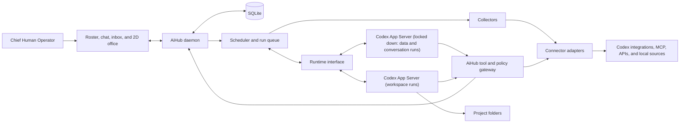

# AiHub design document

## Purpose and scope

AiHub is a local, game-like office for your personal workforce. You are the Chief Human Operator. Your Chief of Staff turns goals into standing responsibilities, recruits a supervisor for each area you hand over, delegates assignments, and brings you findings and decisions. Supervisors can later commission temporary workers for bounded tasks.

The core feature is creating a new responsibility at runtime. Work schedules, separate inboxes, and portfolio research are examples of responsibilities that share the same staff model. New responsibilities use available capabilities. A new service or action becomes available through a connector. Over time, staff move from watching and reporting to preparing drafts, working on projects, and acting within limits the operator sets. Bookkeeping, side projects, research, and shopping are examples of what the same staff model can take on.

V1 runs on one Windows PC and covers watching and reporting. The first release validates recruitment, delegation, scheduled reporting, and run isolation with sample data and one real local source. Results arrive in the AiHub inbox. Local state stays on the primary PC. Temporary workers follow once the core loop is in daily use. Drafts, project work, approvals from the phone, and spending follow in the phases under Roadmap after V1. Obsidian export and cross-PC sync are deferred.

### Design rules

- **The model proposes; the daemon decides.** The daemon validates, records, and applies every action.
- **SQLite is the memory.** Model threads are disposable. Every run can be rebuilt from records.
- **Code collects; the model interprets.** Fetching, diffing, and condition checks run as code. A model turn runs only when there is something to interpret.
- **Rules live in code, not in prompts.** Hiring, access, drafts, and spending limits are enforced by the daemon. Instructions tell staff how to work; they never grant authority.

## The office experience

The 2D office is the home screen. The Chief of Staff has a permanent desk, supervisors get desks when recruited, and temporary workers appear while their assignments are active. Avatars and badges reflect actual run state such as queued, collecting, working, reviewing, waiting for access, waiting for approval, or done. Selecting an agent opens its charter, responsibility, assignments, recent activity, next run, and a chat with it.

The office is one view of the same state stream that drives the staff roster and activity feed. The roster, feed, and chat ship first. The office renders from them and holds no state of its own.

The Chief of Staff desk opens a persistent chat with streamed replies, unread briefings, and approval cards. The operator can inspect tasks, approve or decline proposals and actions, pause a routine, stop a run, dismiss or resolve an item, and trace a briefing item to its assignment and sources.

Every staff member can be talked to. A chat with a supervisor is grounded in its charter, notes, and current work, and anything it agrees to do becomes an assignment through the gateway. The operator can also call a meeting: several staff discuss one topic in a shared thread, the Chief of Staff chairs it, and the outcome is recorded as decisions and assignments.

A single request can establish multiple roles:

> Set up staff to watch my work schedule, my work and personal inboxes separately, and my portfolio. Give me one rundown on weekday mornings. Flag anything urgent in AiHub.

| Supervisor | Responsibility | Example output |
| --- | --- | --- |
| Work Schedule | Watch the work calendar for changes, conflicts, and preparation. | The planning meeting moved to 10:00 and overlaps the project review. |
| Work Inbox | Triage the connected work mailbox according to work priorities. | Two threads need a decision today, with the questions and source links. |
| Personal Inbox | Monitor a separate mailbox with its own access and priorities. | A renewal notice arrived and the response is due Friday. |
| Portfolio | Review holdings, watchlists, filings, and market data against operator-defined criteria. | A holding matched a review rule, with the source and the last refresh time. |

The Chief of Staff proposes new roles or reuses existing ones, identifies the required connections, and drafts the briefing routine. The operator approves the setup from one card. Missing access leaves the relevant responsibility waiting for connection. AiHub resumes eligible work after verifying the connection.

## Architecture

- **Web UI.** React with Vite. Serve the interface from the local Fastify daemon bound to loopback. Use HTTP for commands and server-sent events for streamed replies, run state, and office activity. On reconnect, load the current state before continuing the event stream.
- **Loopback hardening.** Loopback keeps other machines out, but not other pages open in the operator's browser. Reject requests whose `Host` header is not the daemon's loopback address and port, which blocks DNS rebinding. Reject state-changing requests whose `Origin` is not the AiHub UI. Require a per-install token, generated at setup, on every API and event-stream request; a `SameSite=Strict` cookie works with `EventSource`. Send no permissive CORS headers.
- **Local control plane.** A TypeScript daemon owns the roster, responsibilities, assignments, routines, items, permissions, activity history, and scheduling. SQLite is the source of truth, so the office recovers after a daemon restart, a browser refresh, or a Codex upgrade.
- **Runtime interface.** The daemon reaches the model runtime through its own interface: start a context, run a turn with assembled context and an allowed tool list, stream events, receive tool calls, and report usage. Contract tests target this interface. Codex App Server is the first implementation. Another runtime can replace it for some or all runs without changing the staff engine; the Claude API is the planned fallback for data runs.
- **Codex runtime.** Launch a pinned version of `codex app-server` as a background child process over stdio. Use Codex-managed ChatGPT sign-in for the personal local build. Contract-test the experimental dynamic tool interface. The pinned 0.167.0 runs on Windows; the earlier `Unsupported platform: win32 (x64)` error came from an old global install. [Codex CLI](https://learn.chatgpt.com/docs/codex/cli) · [Codex App Server](https://learn.chatgpt.com/docs/app-server)
- **Run profiles.** A run's profile decides which tools and data it can reach. Codex features apply to a whole app-server process, so each kind of process gets its own `CODEX_HOME`, feature set, execution slots, and budget. A long workspace run never blocks the morning briefing.

  | Profile | Used for | Tools | Data |
  | --- | --- | --- | --- |
  | Data | Supervisors that read mail, calendars, finances, and other personal sources | Gateway tools only, in the locked-down process | The sources its grants allow |
  | Conversation | Chats and meetings with the operator | Gateway tools only, in the locked-down process | Summaries and items that staff can share, not raw sources |
  | Workspace | Project work, such as a side project's code | Shell and files inside one project folder or git worktree, plus gateway tools | No personal sources or their connectors |
- **Context assembly.** Every run starts from records: the agent's charter, its responsibility and standing instructions, source-linked notes, open items, recent results, and the change set since its cursor. Codex threads are a cache. The Chief of Staff chat resumes its saved thread ID for continuity. If that thread is lost, too long, or incompatible after an upgrade, AiHub starts a new one from records and recent chat history. Background runs start a fresh context each time.
- **Tool and policy gateway.** Expose typed staff, scheduling, and connector operations. Identify the caller from the active run and validate its role, responsibility, account grant, and arguments before executing a call. A model can propose an action. The daemon records and applies it after validation.
- **Collectors.** Deterministic code fetches changes from a connection since a saved cursor, normalizes them into source records, and compares them with known items. Collectors use no model turns.
- **Windows lifecycle.** Start the daemon at Windows sign-in under the operator's account. Closing the browser leaves scheduled work running. Before each briefing's health check, a Task Scheduler task with "Wake the computer to run this task" enabled wakes the PC where power settings allow wake timers. The task only wakes the machine; the daemon still owns scheduling. If the PC stays asleep or off, execution is deferred until it is available.

## Staff and work model

| Record | Purpose |
| --- | --- |
| Agent | Persistent identity, role, manager, charter, run profile, and lifecycle state. |
| Responsibility | An ongoing or time-bounded outcome with an owner, scope, initiative policy, reporting rules, success criteria, and optional expiry. |
| Routine | Trigger, owner, instructions, delivery destination, turn budget, and pause state. |
| Assignment | Bounded work with an owner, inputs, expected result, and optional parent assignment and review requirement. |
| Run | An execution attempt with status, timestamps, turn and usage counts, and failure details. |
| Result | A report for an assignment with source references, freshness, and decisions needed. It references items rather than restating them. |
| Item | A finding with a stable identity from its source, such as a mail thread ID or a calendar event ID and version. It has a state (new, open, resolved, or dismissed), first-seen and last-reported times, and an owning responsibility. |
| Cursor | The last position a responsibility has checked on a connection, so collectors fetch only what changed. |
| Proposal | A change that needs operator approval: a new supervisor, responsibility, routine, or access request. |
| Action | A step outside AiHub's own records, such as a draft to create, a listing to publish, or a purchase. It has an autonomy level, a target connection, a cost if any, evidence, and a status (proposed, approved, done, failed, or declined). |
| Conversation | A chat between the operator and one staff member, or a meeting with several. It keeps the transcript and links to the decisions and assignments it produced. |
| Connection | An authenticated account or an identified local resource, such as a mailbox or a project folder. |
| Grant | The agents, operations, scope, and limits, such as a daily spending cap, allowed for a specific connection. |

In V1 each supervisor owns exactly one responsibility. The roster shows it as a staff member; the engine treats it as that responsibility's owner. The Chief of Staff owns the briefing and any mandates.

### Recruitment and delegation

The Chief of Staff can propose new supervisors or reuse existing ones within standing goals. Each proposal includes a charter, reporting relationship, responsibility, routine, and requested capabilities. Requested capabilities can exceed current access so the office can prepare the role while you connect a service. The operator approves, edits, or declines the proposal from a card in the Chief of Staff inbox. Once a role exists, the Chief of Staff can assign work within it without further approval.

AiHub caps the number of active supervisors and the daily turn budget. A proposal that would exceed either cap says so. Before proposing a new role, the Chief of Staff checks existing responsibilities for overlap and proposes extending one where it fits.

Delegation returns an assignment ID immediately. No model turn stays open while it waits. The delegating turn ends after the assignment is recorded. When the dependencies finish, the daemon starts a new turn for the parent with their results. V1 starts with one execution slot. Interactive chat gets priority when the slot becomes free.

Temporary workers follow once the core loop is in daily use. A supervisor will be able to commission a worker for a bounded assignment. The worker receives a deliverable, a deadline or turn budget, and only the relevant subset of the supervisor's access. The supervisor reviews the output and AiHub archives the worker when its work ends. The assignment and result remain inspectable. Delegation stays capped at three levels: Chief of Staff, supervisor, and temporary worker.

### Autonomy levels

Every operation an adapter offers has an autonomy level, set by how easily its effect can be undone. The level decides who must approve it.

| Level | Examples | Who approves |
| --- | --- | --- |
| Observe and report | Briefings, alerts, research | Nobody; it runs automatically. |
| Prepare | Draft ledger entries, a mail draft, an unpublished listing | Nobody to create it; the operator reviews the result. |
| Act inside AiHub's own space | Commit to a project branch, update AiHub's own records | The Chief of Staff, within the responsibility's scope. |
| Act outside, reversibly | Publish a listing, fill a shopping cart, accept a meeting | The operator, unless a policy allows it. |
| Spend money or act irreversibly | Buy, pay, send mail, place a trade | The operator, with the cost shown, unless a narrow policy covers it within a cap. |

Staff take work out into the real world through Prepare operations, so nothing goes live without the operator. A policy can pre-approve a narrow case, such as groceries under 300 kr from listed shops. Policies are grants with limits, and the gateway enforces them. Only a role with a spending grant can propose a purchase, and never above its daily cap.

Staff-initiated activity that serves no assignment, such as meetings among staff or notes about each other, is optional. It is off by default and runs on its own daily budget when enabled.

### Autonomy and knowledge

The Chief of Staff can delegate and arrange internal follow-ups to meet standing goals. An operator can grant a mandate for broader initiative. A mandate is a responsibility with an expiry and a wider initiative policy. For example, a two-week mandate to review meeting load lets the Chief of Staff identify tasks, assign work, and arrange a follow-up within that scope without a proposal for each step. Expiry or revocation blocks further actions under the mandate. New roles under a mandate still need approval unless the mandate allows them. New account access always requires operator authorization.

Store standing instructions with responsibilities and source-linked notes with supervisors. For example, asking to always surface payroll messages that need a response becomes an editable instruction. Sharing a summary with the Chief of Staff and granting it access to the underlying mailbox are separate decisions.

Operator actions on items are also knowledge. A dismissed item stays out of later briefings unless its source changes. A resolved item records how it was resolved.

## Connectors and capabilities

A provider can expose multiple connections. One mail adapter can serve a work mailbox and a personal mailbox, with each supervisor granted operations on its own connection. A portfolio supervisor can receive access to a holdings CSV and a market-data source independently.

Adapters declare typed operations, whether they read or change external state, each operation's autonomy level, authentication requirements, how results identify source records, and an optional incremental fetch that collectors call with a cursor. The lifecycle is discovery, connection, verification, grant, use, reconnection, and revocation.

An adapter can offer draft-only operations, such as creating a mail draft or an unpublished listing, alongside separate operations that send or publish. Granting only the draft operations lets a supervisor finish real work while the operator keeps the final step.

| Integration path | When to use it |
| --- | --- |
| Existing Codex integration | Preferred when the background runtime can verify the intended account, use bounded operations, and enforce the required scope. |
| MCP or direct API adapter | Use when an existing integration is unavailable or tighter account isolation, polling, or recovery is required. |
| Local file or folder | Use for holdings exports, documents, project files, and other explicitly selected local resources. |
| Custom adapter | Add new services and operations through the same typed contract. |

Codex App Server exposes connector status and MCP calls. Its plugin installation endpoints are under development. Keep installation in Codex and verify what AiHub's background runtime can use. If a connector cannot enforce the required account and operation boundaries, qualify a direct or MCP adapter instead. [Codex App Server](https://learn.chatgpt.com/docs/app-server)

When AiHub lacks a capability, the Chief of Staff can draft the responsibility, identify the missing capability, and propose a connection or custom adapter. Market coverage, freshness, and any provider cost depend on the selected data source. AiHub and the sample workflows require no separate OpenAI API key or paid service beyond existing Codex access.

## Scheduling and reporting

V1 supports on-demand work, schedules, assignment completion triggers, and polling rules. Use `Europe/Stockholm` as the default timezone.

Every routine runs in two phases. First, collectors fetch changes since the cursor and compare them with known items without using the model. Second, a model turn runs only when there are changes to interpret, open items to reassess, or a report is due. Polling rules define a check interval, a condition, and a deduplication policy. Evaluate conditions in code where possible, such as a new message from a listed sender or a holding crossing a threshold. Escalate to a model turn only when a match needs interpretation.

A weekday briefing runs as follows:

1. The scheduler creates a unique occurrence with a delivery time and a cutoff.
2. One hour before delivery, a health check verifies Codex sign-in, connection status, and remaining usage. A failure posts an actionable alert to the AiHub inbox right away so the operator can fix it before the briefing.
3. Collectors fetch changes for each participating responsibility. A responsibility with no changes and no open items reports "checked, nothing new" without a model turn.
4. Supervisors with changes run one turn each to interpret them against their charter and standing instructions. They create, update, or resolve items. Their results distinguish an unavailable or stale source from a successful check that found nothing.
5. The Chief of Staff composes the rundown from the reports those roles can share. New items come first. Open items carried over are summarized rather than repeated. Items resolved since the last briefing are noted, and dismissed items are left out. If a section misses the cutoff, the briefing identifies what is missing.
6. AiHub posts one unread briefing in the Chief of Staff inbox and links each entry to its item, assignment, and sources. Configured polling rules can deliver separate alerts between briefings.

Each routine has a turn budget, and AiHub records usage per routine and per day. Codex background jobs and interactive chat draw from the same plan allowance, including the operator's own Codex use outside AiHub. When the budget or allowance runs low, background work defers to its next occurrence and the briefing says so. [Codex usage limits](https://learn.chatgpt.com/docs/pricing)

Persist occurrence IDs and attempts to deduplicate delivery across retries and restarts. Catch up once for the latest missed briefing after sleep or downtime. Show actionable reasons when a run is waiting for access, internet connectivity, or Codex allowance. Future external writes with an uncertain outcome require reconciliation before retrying.

## Authority and data boundaries

- Check the current role, responsibility, and grants when a job starts and before every tool call. Delegation can only narrow access.
- Treat mail, documents, webpages, and feeds as data. A data-reading run gets only the gateway tools its grants allow. Milestone 1 must show, on Windows, that such a run:
  - uses a dedicated `CODEX_HOME` with no MCP servers, plugins, or connectors other than the AiHub gateway;
  - runs in an app-server process started with ChatGPT apps, browser and computer use, the shell tool, image viewing, and tool installation disabled. With default features, ChatGPT apps provide web search even when `web_search` is disabled;
  - starts in an empty working directory with a read-only sandbox and web search disabled;
  - cannot run a shell command or change a file without an approval request, which the daemon declines;
  - cannot read files outside its working directory through any tool.

  If Codex cannot meet these on Windows, data-reading runs move to another runtime behind the runtime interface.
- No run combines personal data, untrusted content, and a way to act outside AiHub. Data runs have no outbound tools, workspace runs have no personal data, and anything above the Prepare level goes through approval. An injected instruction can then distort a report but cannot move data out.
- V1 covers reading, monitoring, analysis, reporting, and internal coordination. Drafts, project work, and spending follow in the phases under Roadmap after V1, each with its own grants and approval policies.
- Staff never see or hold payment card details. A purchase ends in a checkout the operator completes, or later in a payment method with its own hard cap.
- The daemon's HTTP surface follows the loopback hardening rules above. It holds mailbox access and is treated as a sensitive service.
- Keep credentials out of prompts and logs. Store selected findings and source references by default. Local hosting keeps AiHub's state on the PC. Selected data sent to Codex for reasoning is processed by the model service, and the connection flow should make that clear.

## Build sequence and acceptance

| Milestone | Acceptance |
| --- | --- |
| 1. Runtime, isolation, and control surface | The Windows daemon starts Codex, signs in, streams a reply, and invokes a gateway tool through the runtime interface. The Chief of Staff chat and roster restore after restart, and the chat rebuilds from records when its thread is discarded. A data-reading run passes the isolation checks. The daemon rejects requests with a foreign `Host` or `Origin` or a missing token. A simulated four-section briefing completes, with its turns and usage recorded. The roster, activity feed, and chat reflect real run state. |
| 2. Staff, approvals, and one real source | A chat request produces a proposal, and approving it creates a supervisor, a responsibility, and a routine. One real local source, such as a calendar export or holdings CSV, feeds a briefing the operator reads daily. An unchanged item is not reported as new the next day, and a dismissed item stays out. Ending a mandate blocks further actions under it. |
| 3. Generality with sample sources | Configure a calendar, two isolated mailboxes, and a portfolio responsibility using the same staff engine. Add a fifth responsibility in chat and a small new adapter without changing the hierarchy or scheduler. The 2D office renders run state from the same event stream as the roster. The operator can open a chat with any staff member from the office. |
| 4. Background operation | Briefings and alerts arrive with the browser closed and after the PC wakes from sleep. Test restart, duplicate triggers, stale data, revoked access, failed supervisors, exhausted Codex usage, and an expired sign-in caught by the health check. Responsibilities with nothing new use no model turn. |
| 5. Real integrations | Qualify an existing Codex connector and a local file or custom adapter through the same contract. Verify account isolation, unattended operation, reconnect, source links, and partial results. |
| 6. Temporary workers | A supervisor commissions a worker with narrowed access, reviews its result, and the worker leaves the active office. The assignment and result remain inspectable. |

The defining acceptance test is recruiting a supervisor for a responsibility AiHub has never seen. The Chief of Staff must be able to define its charter, match it to available capabilities, request missing access, propose a schedule, and, once approved, report through the existing office.

## Roadmap after V1

Each phase adds one kind of doing, ordered from the easiest to undo to the hardest. Each starts only when the previous one is in daily use.

| Phase | Adds | Acceptance |
| --- | --- | --- |
| A. Drafts and meetings | Draft-only operations, the Action record, an approval queue, and meetings | A supervisor prepares a mail draft or draft ledger entries that appear in the approval queue, and no granted operation can send or post them. A meeting with three staff ends with recorded decisions and assignments. |
| B. Workspace runs | The workspace profile, with project folders as connections | A supervisor works on a side project on its own git branch, runs its tests, and reports. It cannot reach personal data connectors, and a long workspace run does not delay the briefing. |
| C. Approvals away from the PC | Phone notifications and answering approvals from the phone | An approval raised while the operator is away is answered from the phone, and the daemon enforces the answer. |
| D. Spending | A spending grant with a daily cap and policies for narrow pre-approved cases | Only the role with the spending grant can propose a purchase. The gateway refuses one above the cap, and the operator completes every checkout that no policy covers. Staff never see card details. |
